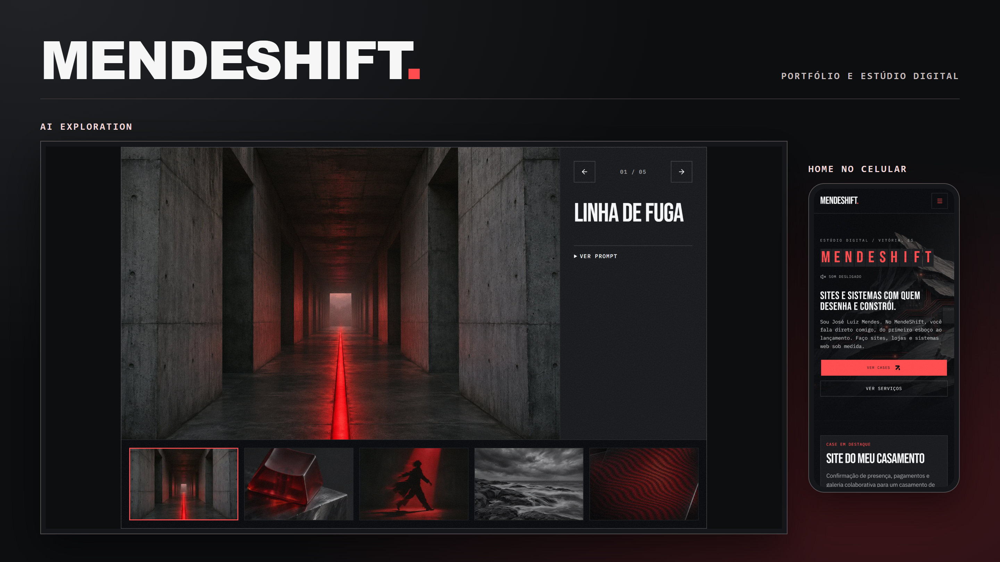

# MendeShift

<p align="center"></p>

Portfólio e estúdio digital de José Luiz Mendes. O site reúne estudos de caso, artigos técnicos e experimentos de imagem e interação no navegador.

[Ver o MendeShift em produção](https://mende-shift.vercel.app/pt)

## Stack

| Camada | Tecnologia |
| --- | --- |
| Framework | Next.js 16 (App Router) · React 19 · TypeScript |
| Estilo | Tailwind CSS 4 |
| Animação | GSAP + Lenis · shaders WebGL |
| i18n | next-intl (PT/EN) |
| Formulários | React Hook Form + Zod |
| E-mail / leads | Resend |
| Rate limiting | Upstash Redis |
| Observabilidade | Vercel Analytics + Speed Insights |
| Deploy | Vercel · build Docker multi-stage |

## O que tem

- **Cases** com composições editoriais de interfaces reais, contexto de projeto e decisões de engenharia. [Abrir Cases](https://mende-shift.vercel.app/pt/projetos)
- **AI Exploration** com cinco estudos visuais gerados no ImageGen, imagens WebP responsivas, granulação aplicada na galeria e prompts disponíveis para copiar. [Abrir AI Exploration](https://mende-shift.vercel.app/pt/ai-exploration)
- **O Estúdio e Processo** com retrato interativo em WebGL e um quebra-cabeça 3D cuja montagem acompanha a rolagem.
- **Blog bilíngue** com artigos em MDX versionados no repositório. [Abrir o blog](https://mende-shift.vercel.app/pt/blog)
- **Chatbot de contato** com visual de terminal, Gemini, rate limit por IP, teto diário global e captação de leads pela conversa.
- **Formulário de briefing** com honeypot anti-spam, rate limit próprio e fallback por WhatsApp se a API cair.

## Rodando

Requer **pnpm**. O app fica em `mendeshift/`.

```bash
cd mendeshift
pnpm install
pnpm dev
```

Consulte o [README do app](mendeshift/README.md) para configurar Gemini, Resend e Upstash e localizar os arquivos de cada recurso.

## Licença

MIT.
